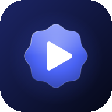
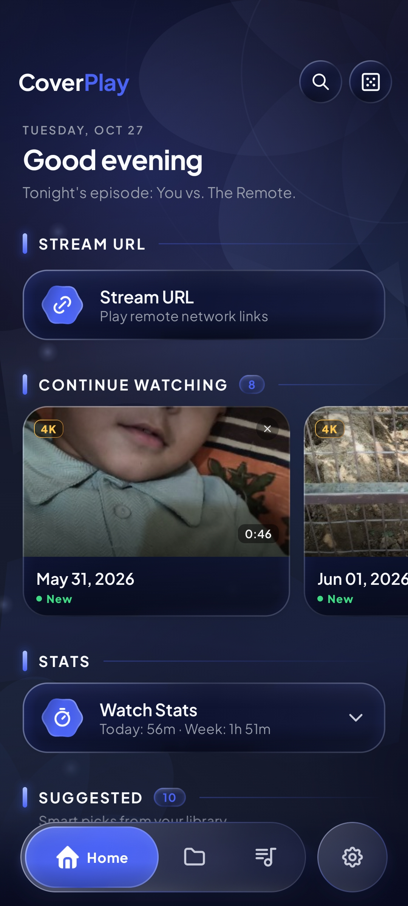
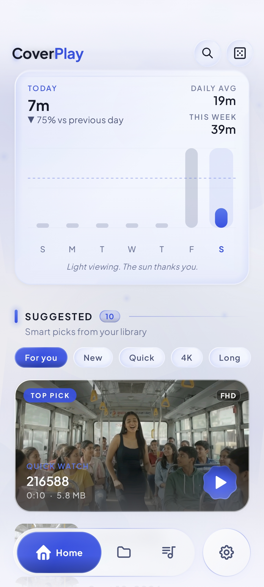
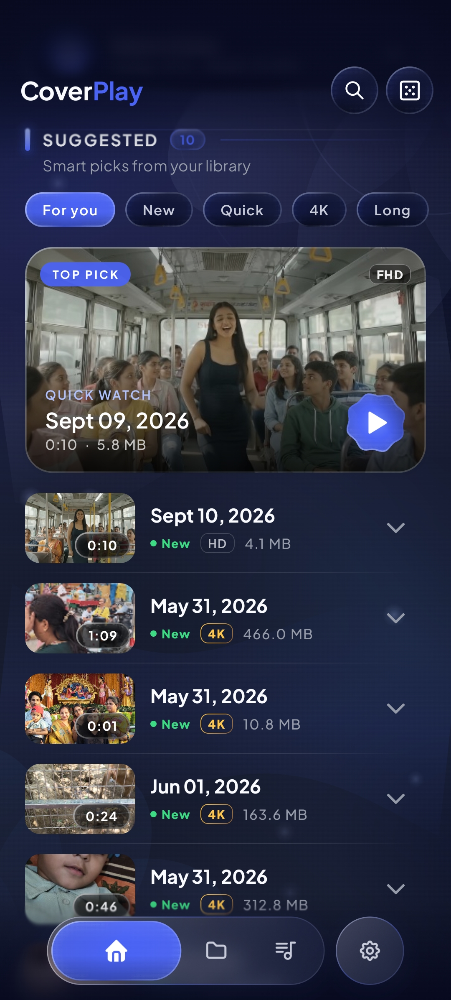
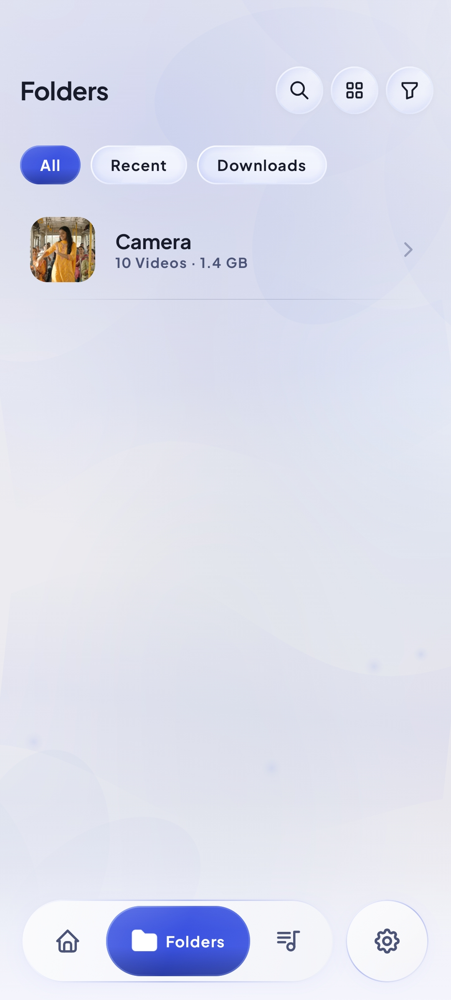
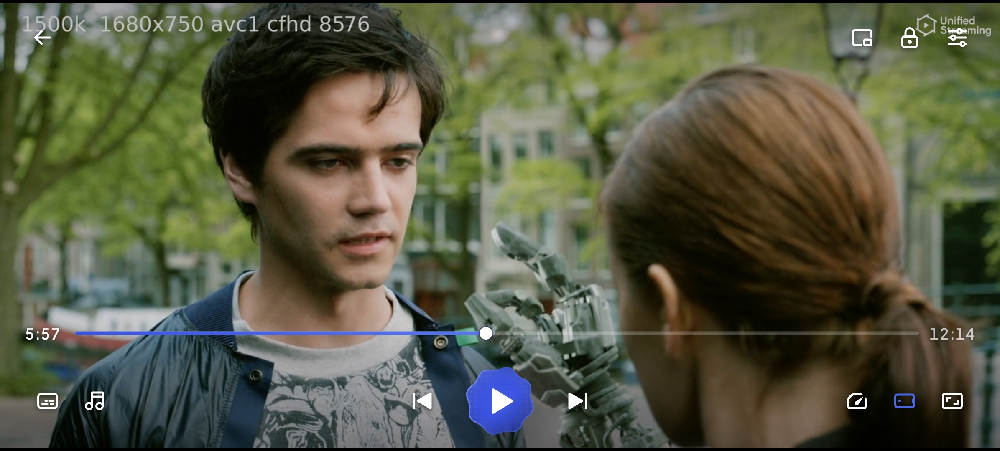

# CoverPlay

### A video player that looks as good as your videos.

Open source. Zero ads. Zero tracking. Just a beautiful, gesture-first player built for Android.

 

 

  

---

## What's new in v3.0.5

- **Cleaner**: a more refined, uncluttered interface
- **Faster**: quicker launch, browsing and playback response
- **Smoother**: polished animations and transitions throughout
- **Bug fixes**: stability and playback issues resolved

---

## Download

Grab the latest APK from the [Releases](../../releases/latest) page, open it, and install. If Android asks, allow installs from your browser or file manager.

---

## Why CoverPlay?

Most video players make you choose: clean or capable, free or respectful. CoverPlay doesn't.

| | |
|---|---|
| **No ads. Ever.** | No banners, no popups, no "upgrade to remove ads". |
| **Open source** | Every line is here. Read it, fork it, improve it. |
| **Private by design** | Watch history and usage stats stay on your device. |
| **Premium UI** | Glass surfaces, cinematic controls, fluid motion. |
| **Gesture-first** | Swipe, pinch, long-press. The player gets out of your way. |
| **Made to be themed** | Five hand-tuned themes, each with its own matching app icon. |

---

## Features

### Cinematic player

- **Clean, modern controls**: bare icons with soft shadows, minimal gradients, and a single hero play button. Nothing covers your video.
- **Compact gesture feedback**: short, quiet pills like `Fit`, `Paused`, `2x`, not noisy popups.
- **Aspect modes**: Fit, Fill and Zoom in a tap.
- **Smooth scrubber** with chapter support and a live preview card.
- **Playback speed** control, plus **long-press for 2x** and release to return.
- **Lock mode** to stop accidental touches.
- **Landscape and portrait layouts**, each designed on its own. In portrait the video sits on a softly blurred backdrop pulled from the video itself.
- **Picture-in-Picture** with the correct aspect ratio for each video.
- **Background play** to keep audio going when the app is closed.
- **Shuffle and repeat** (off, one, all).

### Gestures

| Gesture | Action |
|---|---|
| Swipe left side | Brightness |
| Swipe right side | Volume, with boost above 100% |
| Pinch | Zoom and pan the video |
| Long-press | Hold for 2x speed |
| Double-tap | Seek back or forward |
| Tap | Show or hide controls |

### Subtitles and audio

- Switch **audio tracks** and **subtitle tracks** on the fly.
- Online subtitle search through OpenSubtitles.
- Software decoding fallback through FFmpeg-based renderers for files hardware decoders can't handle.

### Library and streaming

- **Folder browsing** with list or grid layouts and multiple sort orders.
- **Continue Watching** with resume prompts ("Resumed at 12:34, Start over").
- **Playlists** and quick folder browsing from inside the player.
- **Stream URL**: paste a link and play. Direct links, **HLS (.m3u8)** and **DASH (.mpd)** are supported.
- **Rename, move and delete** videos using Android's scoped storage, with proper system consent dialogs.

### Themes

Pick a look that feels like yours. The whole app recolours live, and the launcher icon can follow.

| Theme | Vibe |
|---|---|
| **Iris Royal** | Deep, confident blue |
| **Neon Violet** | Electric purple |
| **Cyber Magenta** | Bold rose |
| **Solar Ember** | Warm orange glow |
| **Hyper Cyan** | Cool aurora |

Light and dark modes are both supported, and the launcher icon can **sync with your theme**.

### Stats

A calm weekly chart of the time you spend watching, with daily average and day-over-day change. It is stored **locally only** (30 days, auto-pruned) and never leaves your phone.

### A little personality

CoverPlay has a sense of humour. Expect witty one-liners in dialogs and stats, a joke screen for corrupt videos, and a hidden developer-mode easter egg. You can skip them all and still enjoy a serious player.

---

## Built with

- **Kotlin** and **Jetpack Compose**
- **Material 3** with a custom glass design system
- **Media3 / ExoPlayer** for playback
- **Coil** for thumbnails and video frames
- **Plus Jakarta Sans** typography
- **MediaStore** and scoped storage for file operations

---

## Privacy

- No ads and no analytics SDKs.
- No account and no sign-in.
- Watch history and stats are stored on-device only.
- Network is used only when **you** stream a link or search subtitles.

---

## Changelog

### v3.0.5
- Cleaner, faster, smoother experience
- Bug fixes and stability improvements

---

## Contributing

Contributions are welcome.

1. Fork the repo
2. Create a branch: `git checkout -b feature/my-idea`
3. Commit your changes
4. Open a pull request

Bug reports and feature ideas are just as valuable. Open an issue and describe what you'd like to see.

---

## Support the project

CoverPlay is free and always will be. If it made your videos feel better, you can:

- Star the repo
- Share it with a friend
- Support the developer via **UPI** from the *About Developer* screen in the app

---

## License

Released under the [MIT License](LICENSE). ExoPlayer/Media3 is used under the Apache 2.0 License.

---

**Made with care by [raman-codes-6368](https://github.com/raman-codes-6368)**

*No ads. No noise. Just your video.*

